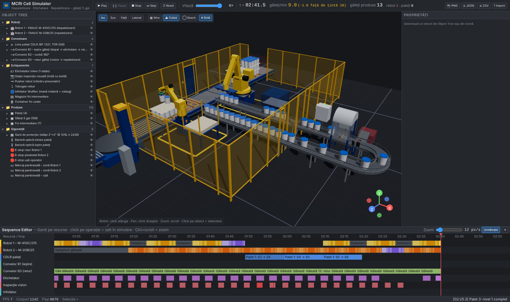

# MCRI Cell Simulator

Mockup funcțional de simulator de celulă robotizată, în stil Siemens Process Simulate, realizat ca aplicație web statică (fără backend).
Modelează celula **MCRI de depaletizare / repaletizare găleți de 5 gal** cu etichetare inline și inspecție vizuală, țintă **10 găleți/min**
(referință: clip Motion Controls Robotics, YouTube `SWpIWw1aGKk`).

Lucrare de licență – UPB FIIR, Mecatronică și Robotică.

**Demo (GitHub Pages):** https://johnnyarg14.github.io/mcri-cell-simulator/ (activ după primul push și activarea Pages – vezi [Publicare](#publicare-pe-github-pages)).



## Funcționalități

| Zonă | Conținut |
| --- | --- |
| Bară sus | Play / Pause / Stop / Step, viteză 0,25×–8×, ceas simulare `mm:ss.d`, debit live găleți/min (+ deficit/excedent față de țintă), găleți produse, rebuturi, paleți livrați, Reset, export PNG / JSON / CSV, import secvență JSON |
| Object Tree (300 px) | Foldere Roboți / Conveioare / Echipamente / Produse / Siguranță; click = selectare + evidențiere în 3D; ochi = ascundere |
| Viewport 3D | Grilă pardoseală 1 m, axe + gizmo, OrbitControls, vederi Iso / Sus / Față / Lateral, toggle wireframe, toggle coliziuni, toggle anvelopă de lucru (reach) |
| Proprietăți (340 px) | Roboți: slidere J1–Jn cu limitele din catalog, TCP (X Y Z W P R) prin cinematică directă, „Jog to target” prin cinematică inversă, puncte învățate (+ învățare puncte noi). Conveioare: viteză, Run / Stop / Accumulate, stare opritoare PCS19 și fotocelule. Stații: timpi și contoare. |
| Sequence Editor (220 px, pliabil) | Gantt cu o bandă per resursă (Robot 1, Robot 2, CDLR paleți, B1, B3, etichetator, vision, infoliator), operații colorate, cursor de timp, zoom (slider / Ctrl+scroll), **click pe o operație = salt determinist al simulării la momentul ei** |
| Bară de stare | FPS, număr de corpuri, mesaje (ex. `Coliziune: Gripper R1 ↔ Ghidaj lateral B1`) |

Scurtături: `Space` Play/Pause · `→` Step · `Shift+R` Reset.

### Mod Auto / Manual

- **Auto** – secvența din `sequence.json` conduce roboții (depal → etichetare → inspecție → repal → înfoliere).
- **Manual** (buton în bara de sus sau tabul **Program**) – tu conduci roboții, ca într-un teach pendant:
  - jog pe axe (slidere) sau **Jog to target** (IK) din tabul Proprietăți, apoi **+ Locație** memorează poziția axelor în program;
  - pași **Prindere** (ia produsele aflate sub sculă – rândul de găleți sub placa de strat, o găleată sau o foaie sub gripperul cu 4 ventuze, foaia de deasupra magaziei), **Eliberare** (așază pe conveior, pe palet – peste produsul de dedesubt – sau pe pardoseală/container), **Așteptare**;
  - **Rulează programul** (opțional în buclă, viteză globală % și per locație); programul se salvează în browser și se poate exporta/importa ca JSON;
  - comenzi directe: Prinde/Eliberează acum, HOME, + palet plin la S1, + palet gol la S7, + găleată pe B1, golire celulă.
  Conveioarele și stațiile funcționează la fel în ambele moduri, așa că poți construi manual tot ciclul.

### Celulă goală + propriile modele CAD + animație pe cadre

Butonul **Celulă goală** (bara de sus) ascunde celula MCRI și lasă doar pardoseala: aici construiești celula ta din modele glTF.

- **Plasare**: trage `.glb` peste viewport; mută/rotește cu **gizmo** (G = mutare, E = rotire, snap 10 mm / 5°) sau numeric din tabul Modele CAD.
- **Ierarhie**: fiecare model poate avea un **părinte** (poziția/rotația devin relative la părinte). Așa articulezi un robot din piese:
  bază → braț → antebraț → sculă; rotind părintele se mișcă tot lanțul.
- **Animație pe cadre** (panoul de jos, tabul *Animație*): timeline cu fps și lungime, piste per obiect, chei ◆ (poziție, rotație, scară, vizibilitate;
  pentru roboții MCRI – valorile axelor), interpolare liniară sau lină, scrub cu mouse-ul, drag al cheilor, redare în buclă, pas cadru cu cadru
  (`,` / `.`), **auto-key** când muți un obiect cu gizmo-ul, export/import JSON. Funcționează și în celula MCRI (ex. keyframes pe Robot 1 și pe un
  model importat).
- **Proiect**: *Salvează proiect* scrie un singur fișier `.mcri.json` cu layout, modele (încorporate), animație și programele robot; *Deschide proiect* îl reîncarcă pe alt calculator.

### Modele CAD din aplicație (tabul „Modele CAD”)

Trage un fișier `.glb`/`.gltf` peste viewport sau folosește tabul **Modele CAD**: modelul poate **înlocui** un obiect existent (ex. `EQ_VISION`,
`ROBOT_2_MOUNT`) sau poate fi **plasat liber** ca obiect nou (apare în Object Tree → Echipamente → Modele CAD importate, selectabil în 3D).
Pentru fiecare model setezi scara (mm / m / inch), poziția și rotația (buton „Z↑” pentru modele CAD cu Z în sus). Modelele sunt salvate în
browser (IndexedDB) și revin la reîncărcare; butonul **manifest.json** exportă configurația pentru varianta permanentă din `public/models/`.

## Instalare și rulare

```bash
npm install
npm run dev        # dezvoltare, http://localhost:5173
npm run build      # build static în dist/
npm run preview    # servește dist/
npm run check:ik   # verificare numerică FK/IK pentru punctele de lucru (headless)
npm run check:sim  # rulează 900 s de simulare headless și raportează debitul
```

Stack: Vite + React 19 + TypeScript, Three.js prin `@react-three/fiber` și `@react-three/drei`, Zustand, Tailwind.

## Structura proiectului

```
src/
  config/cell.config.ts   ← TOATE cotele (mm), layout, viteze, poziții, cinematică roboți, culori
  config/sequence.json    ← secvența implicită (durate pași roboți, timpi stații, rată rebut)
  kinematics/fk.ts        ← cinematică directă generală (lanț de articulații, matrice 4×4), conversie WPR
  kinematics/ik.ts        ← cinematică inversă numerică (Jacobian numeric + Damped Least Squares, limite de axe)
  sim/engine.ts           ← motor de simulare cu pași ficși (20 ms): produse, conveioare 1D, paleți, stații, roboți, log Gantt
  sim/conveyor.ts         ← geometrie 1D a traseelor (polilinii), proiecție
  sim/collision.ts        ← corpuri statice (AABB) + AABB gripper
  store/useSimStore.ts    ← stare UI (Zustand)
  scene/                  ← componente 3D parametrizate (gard, CDLR, conveioare, roboți, stații, siguranță, produse)
  components/             ← UI (TopBar, ObjectTree, Viewport, PropertiesPanel, SequenceEditor, StatusBar)
  utils/export.ts         ← export PNG / JSON / CSV, import secvență
public/models/            ← modele glTF opționale + manifest.json
scripts/                  ← verificări headless (tsx)
```

### Sistem de coordonate

Three.js cu **Y în sus**: X = est, Y = înălțime, Z = sud (în vederea de sus Z crește în jos). În panoul de proprietăți TCP-ul este afișat
în convenția robot (Z în sus, ca la FANUC): `X = x`, `Y = −z`, `Z = y`, iar W, P, R sunt unghiuri fixe XYZ. Toate cotele sunt în mm.

## Scena (primitive parametrizate)

Culori: RAL 5017 (structuri MCRI), RAL 1023 (gard/protecții), FANUC yellow (roboți), gri (conveioare).

1. **Gard** – stâlpi 2"×2" la pas 1219, panouri plasă h 2438, 2 tuneluri pentru găleți (est), goluri pentru paleți (nord/sud, cu bariere optice), ușă operator (vest).
2. **Linie paleți** – 10 zone CDLR (BF 1321, role Ø63,5 @ 114, TOR 508): S1 intrare (stivuitor) → S2 buffer → **S3 depaletizare** → S4–S6 transfer palet gol → **S7 repaletizare** → S8 ieșire → S9 masă rotativă infoliator → S10 ieșire. Palet GMA 1219×1016, găleți Ø305×370 pe 3 niveluri (3 rânduri × 4), foi intermediare 1219×1016×4.
3. **Robot 1 – FANUC M-410iC/315** (4 axe, 315 kg, rază 3143) pe riser H 812,8, gripper de strat (placă cu ventuze) care ridică un rând de 4 găleți și scoate foile intermediare în container.
4. **Linie găleți** în buclă (BF 457, TOR 762): B1 ieșire prin tunel → etichetator (2 s) → hotă vision 800 lung cu 1 cameră sus + 2 laterale (1,5 s, 1 din 25 respinsă) → pusher rebut + tobogan → B2 curbă 180° → B3 retur prin al doilea tunel → opritor de capăt pentru Robot 2. Opritoare PCS19 și fotocelule la fiecare stație.
5. **Robot 2 – FANUC M-20iB/25** (6 axe, rază 1853) pe piedestal 500×500 H 900, gripper cu 4 ventuze; cinematică din ROS-Industrial `fanuc_m20ib_support` (J1 650, offset J2 +75, braț 905, J3→J4 120, antebraț 865, J5→flanșă 100). Magazie de foi intermediare (platformă 750, montanți 1000).
6. **Infoliator Wulftec** – masă rotativă Ø1650 + catarg cu cărucior de film, ciclu 60 s; ieșire prin barieră optică.
7. **Siguranță** – E-stop pe riser/piedestal/ușă, bariere optice intrare/ieșire paleți, marcaje pe pardoseală.

## Cinematică

- **FK generală**: lanțul este o listă de elemente `{ translate, axis, coeffs, offsetDeg }`; unghiul fiecărui element = `offset + Σ coeffs[i]·q[i]`.
  Astfel se modelează direct cuplajul paralelogramului M-410 (J3 absolut, încheietură menținută orizontală) fără cod special.
- **IK numerică**: Jacobian prin diferențe finite + Damped Least Squares cu amortizare adaptivă, limite de axe, eroare de orientare prin axă·unghi.
  `solveIKRobust` încearcă mai multe seed-uri (continuitate, seed analitic cu J1 orientat spre țintă, seed din config) și alege postura cea mai naturală.
- Durata unei mișcări = max(durata din `sequence.json`, durata impusă de vitezele de catalog ale axelor).

### TODO de verificat cu cataloagele

În `cell.config.ts` sunt marcate cu `TODO`:
- M-410iC/315: `R1_H1` (bază → axa J2), `R1_A1`, `R1_L2` (braț inferior), `R1_L3` (braț superior), `R1_D4`, limitele J2/J3 (plaje de catalog 144° / 136°) și vitezele – de verificat în RM-410iC(E)-06b.
- M-20iB/25: cuplajul J2/J3 afișat de controlerul FANUC nu este modelat (URDF-ul ROS folosește axe independente).

## Simulare

- Pași ficși de 20 ms, independenți de FPS (acumulator în `useFrame`); butonul Step avansează 0,1 s.
- Produsele (găleți, foi, paleți) sunt entități: pe conveioare se mișcă cu viteza conveiorului pe abscisa `s`, se opresc la opritoare / în acumulare, sunt atașate gripperului în timpul transportului robotic, urmează paletul când acesta se mișcă sau se rotește pe infoliator.
- Secvența este **determinată**: saltul la o operație din Gantt = reset + re-simulare până la momentul ales (verificat în `scripts/check-sim.ts`).
- Debitul live este calculat pe fereastra ultimelor 60 s; media pe întreaga durată apare în exportul CSV.
- Coliziuni: AABB gripper (din cadrul flanșei) vs. corpuri statice (gard, ghidaje laterale, cadre CDLR, stații, montanți, container, catarg). Evidențiere roșie a gripperului și a corpului lovit + mesaj în bara de stare. În secvența automată nu apar coliziuni; testează cu jog manual (ex. Robot 1 → X 2600, Y −1500, Z 800, R 90).

## Secvența (`src/config/sequence.json`)

Fiecare robot are un ciclu de rând/găleată și un ciclu de foaie: liste de pași `{ id, name, target, duration, color, action }` cu
`target ∈ prePick | pick | prePlace | place | dwell | home` și `action ∈ grip | release`. Timpii stațiilor (etichetare 2 s, inspecție 1,5 s
cu `rejectEvery: 25`, înfoliere 60 s) și întârzierea stivuitorului sunt în `stations`. Fișierul poate fi editat direct sau încărcat la
rulare cu butonul **Import** (acceptă și fișierele exportate cu **JSON**). Schema: `src/config/sequence.schema.json`.

## Export

- **PNG** – captură a viewport-ului (rezoluția canvas-ului).
- **JSON** – secvența încărcată + toate operațiile înregistrate (resursă, nume, start, end) + metrici.
- **CSV** – timpii de ciclu pe găleată: `t_depal`, `t_etichetare`, `t_inspectie`, `t_repal`, ciclu total, rebut; plus metrici agregate (separator `;`, UTF-8 BOM pentru Excel).

## Modele CAD (STEP → glTF)

Aplicația înlocuiește automat primitiva unui obiect cu un model glTF dacă acesta este înregistrat în `public/models/manifest.json`:

```json
{
  "EQ_VISION": { "file": "Statie_inspectie_vision_457.glb", "scale": 1, "position": [0, 0, 0], "rotation": [0, 0, 0] },
  "ROBOT_1_MOUNT": { "file": "Riser_M410.glb", "scale": 1000 }
}
```

- cheia = **id-ul obiectului** din Object Tree; `scale: 1` pentru modele în mm, `1000` pentru modele în metri; `position` în mm, `rotation` în grade.
- Modelul este plasat în același cadru ca primitiva: pentru echipamente originea este colțul/centrul definit în `cell.config.ts` (ex. stația vision: centrul la `STATIONS.vision.pos`, Y = 0 la pardoseală); pentru link-urile roboților se folosește cadrul fiecărei articulații (momentan se înlocuiește robotul întreg – pentru link-uri separate adaugă chei `ROBOT_1_J1` … în `Robot.tsx`).

Id-uri utile: `ROBOT_1`, `ROBOT_2`, `TOOL_1`, `TOOL_2`, `ROBOT_1_MOUNT`, `ROBOT_2_MOUNT`, `CDLR_S1`…`CDLR_S10`, `CONV_B1`, `CONV_B2`, `CONV_B3`,
`EQ_LABELER`, `EQ_VISION`, `EQ_PUSHER`, `EQ_CHUTE`, `EQ_WRAPPER`, `EQ_SHEET_MAG`, `EQ_SHEET_BIN`.

### Conversie STEP → glTF

1. **FreeCAD (0.21+)** – `File → Import` STEP, selectează corpurile, `File → Export → glTF (*.glb)`. Verifică unitățile (FreeCAD exportă în mm).
2. **CadQuery / OCP** (Python):
   ```python
   import cadquery as cq
   shape = cq.importers.importStep("Statie_inspectie_vision_457.step")
   cq.exporters.export(shape, "Statie_inspectie_vision_457.glb")   # CadQuery ≥ 2.4 (exportGLTF)
   ```
   Pentru versiuni mai vechi: export STL/OBJ din CadQuery, apoi glTF din Blender (`File → Export → glTF 2.0`).
3. **CAD Exchanger** (cadexchanger.com) – conversie directă STEP → glTF, cu control al toleranței de teselare.
4. Optimizare (opțional): `npx @gltf-transform/cli optimize in.glb out.glb --compress draco` (în acest caz adaugă `DRACOLoader` în `ModelOrPrimitive.tsx`).

Recomandări: simplifică modelele (fără filete/găuri fine), < 5–10 MB per fișier, axa Y în sus (sau setează `rotation: [-90, 0, 0]` pentru modele cu Z în sus).

## Publicare pe GitHub Pages

1. Creează repo-ul pe GitHub (ex. `mcri-cell-simulator`) și fă push pe `main`.
2. În repo: **Settings → Pages → Build and deployment → Source: GitHub Actions**.
3. Workflow-ul `.github/workflows/deploy.yml` construiește cu `BASE_PATH=/<nume-repo>/` și publică `dist/`.
4. Aplicația va fi disponibilă la https://johnnyarg14.github.io/mcri-cell-simulator/.

## Limitări cunoscute (mockup)

- Geometria roboților este aproximativă (primitive); lungimile M-410 sunt estimate – vezi TODO.
- Coliziunile se verifică doar între gripper și corpurile statice (nu între link-uri sau produse).
- Interpolarea mișcărilor este în spațiul articulațiilor (profil smoothstep), nu traiectorii liniare în spațiul cartezian.
- Fără fizică: produsele sunt entități cinematice.
